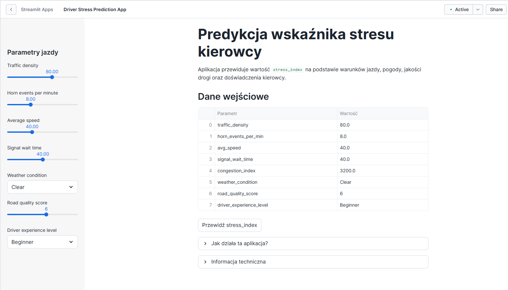
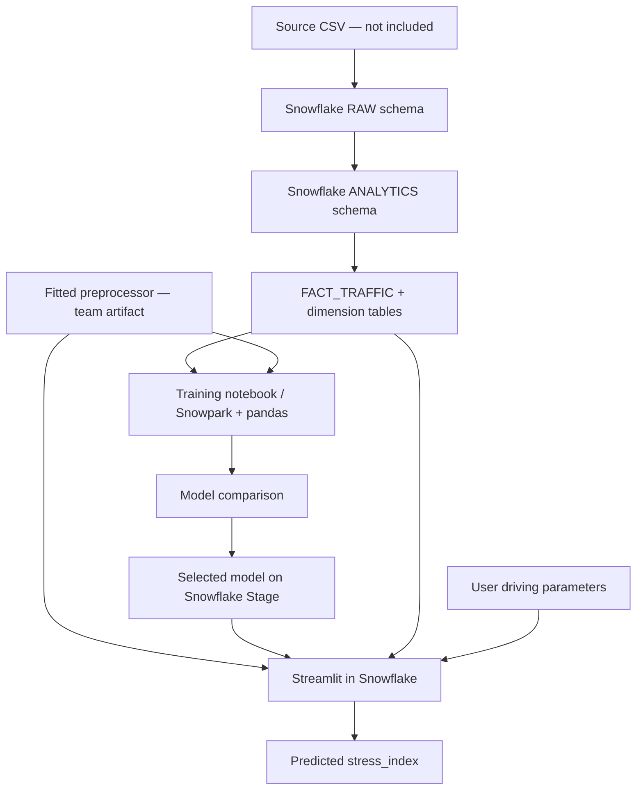
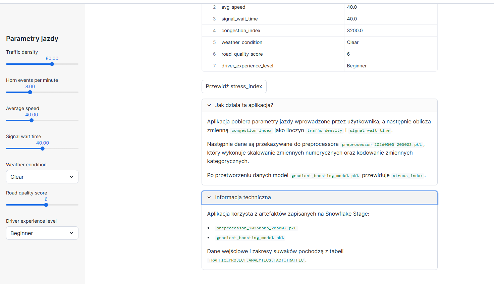

# Traffic Stress Index — Snowflake Data Warehouse, Machine Learning & Streamlit



**Portfolio case study | Data Engineering · Data Science · Machine Learning**

This repository presents the **model training and Streamlit application** components of an academic group project exploring how road conditions and driving-related features relate to a numerical *Traffic Stress Index* (`stress_index`, 0–100).

The original academic project covered CSV ingestion, a Snowflake analytical warehouse, exploratory data analysis, preprocessing, model comparison, and a Streamlit application in Snowflake. **Only the code and materials available for responsible individual publication are included here.** This is *not* the complete source of the whole group's work.

> **Deployment status:** The screenshots document an earlier Streamlit in Snowflake implementation. The included application has been adjusted to match the model-training notebook's six-feature input schema, but that adjustment **has not been verified against live Snowflake artifacts**. The trained model and fitted preprocessor are not included.

## Technology stack

- **Snowflake** — analytical data warehouse, SQL, Snowpark sessions, internal stages, Streamlit in Snowflake
- **Python / pandas / NumPy** — data preparation and analysis
- **scikit-learn** — preprocessing, Linear Regression, Random Forest, Gradient Boosting
- **joblib** — serialization of trained artifacts
- **Streamlit** — interactive user interface for inference

## Solution architecture



The notebook reads data by joining `FACT_TRAFFIC` with `DIM_WEATHER`, `DIM_DRIVER`, and `DIM_ROAD_QUALITY`. The application queries `FACT_TRAFFIC` to set slider limits. These database objects, the fitted preprocessor, and the serialized model must already exist in the target Snowflake account.

## Training and reported results

The academic report describes **50,000 records**, an **80/20 train–test split** (`random_state=42`) and three regression models. Reported test-set performance (from the academic document; **not independently reproduced in this repository**):

| Model | MAE (test) | RMSE (test) | R² (test) |
| --- | ---: | ---: | ---: |
| Linear Regression | 4.2088 | 5.2746 | 0.8946 |
| Random Forest Regressor | 4.0554 | 5.0699 | 0.9026 |
| **Gradient Boosting Regressor** | **3.9449** | **4.9338** | **0.9078** |

Gradient Boosting had the lowest test RMSE in the reported comparison. These are experimental results within the supplied dataset; they should not be interpreted as a validated measure of human stress or real-world predictive effectiveness. The fitted preprocessing process is not fully reproducible from the published files alone.

### Prediction inputs

The training notebook uses **six features**:

`horn_events_per_min`, `avg_speed`, `road_quality_score`, `traffic_density`, `weather_condition`, `driver_experience_level`.

The UI also displays `signal_wait_time` and `congestion_index = traffic_density × signal_wait_time` for context. **These two fields are not used for prediction by the notebook's model**. The earlier screenshot represents an earlier application configuration that needs to be distinguished from the supplied training notebook.

## Repository layout

```text
app/streamlit_app.py               # Streamlit in Snowflake application, portfolio-aligned
notebooks/model_training_snowflake.ipynb  # Snowflake notebook export (no outputs)
config/environment.yml             # Snowflake environment specification from the project
config/pyproject.toml              # Alternative project dependency configuration
screenshots/                       # Screenshots from the earlier Streamlit version
docs/architecture.md               # Data flow and technical boundaries
docs/model_and_data.md             # Feature contract, metrics and limitations
docs/deployment.md                 # Prerequisites and deployment in Snowflake
docs/attribution_and_rights.md     # Attribution, ownership and publication scope
docs/PUBLISHING_GUIDE_PL.md        # Polish step-by-step publication instructions
```

## Running the application

This is **not** a standalone application that works directly with `streamlit run` on a new machine. It uses `get_active_session()` and depends on Snowflake objects plus two trusted model artifacts. For prerequisites and deployment instructions, see **[docs/deployment.md](docs/deployment.md)**.

## Screenshots



## Source and publication scope

This portfolio showcases the **model-comparison notebook** and **Streamlit interface** supplied by the portfolio owner. The broader academic research was a **four-person group project**. The warehouse, earlier exploratory analysis and fitted preprocessing artifacts are described for architectural context only; their source code and the joint thesis text are **not published here**. No full dataset, credentials, trained model or preprocessor is distributed.

Data provenance and redistribution permissions have not been verified, so **the CSV dataset is intentionally excluded**. No open-source license is granted for the repository at this stage; copyright remains with the relevant creators. See [attribution and rights](docs/attribution_and_rights.md).
